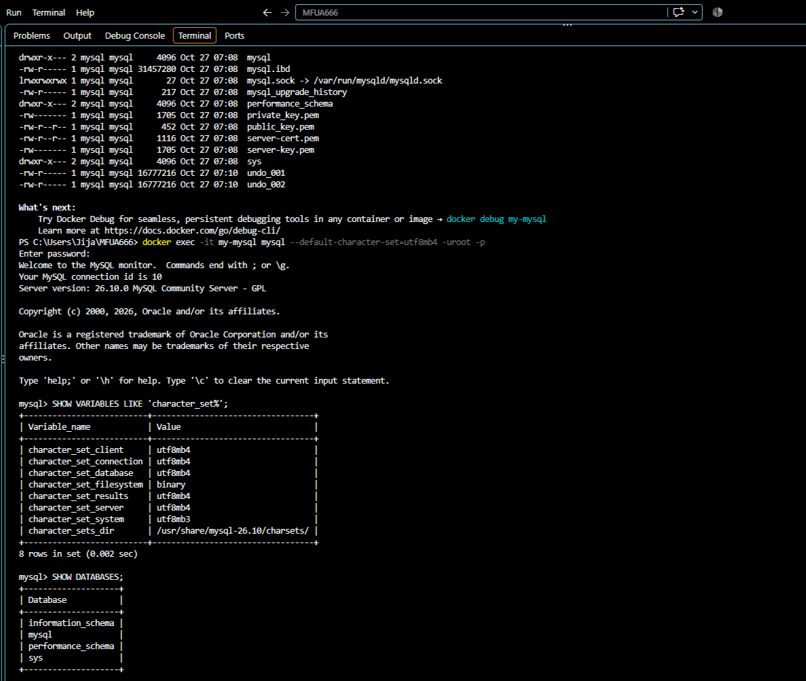
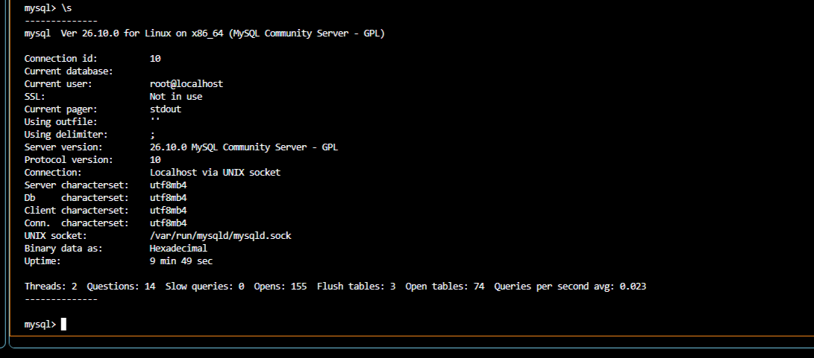
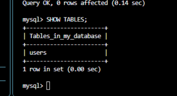
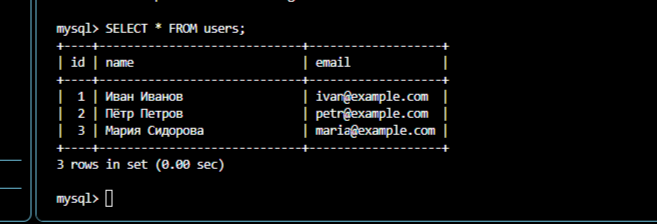
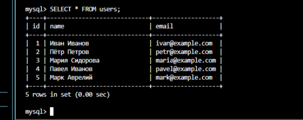
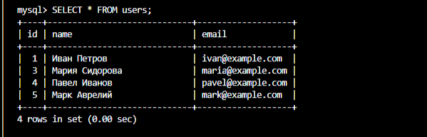
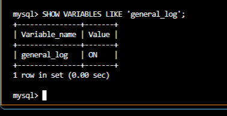

## Шаг 1. Проверка Docker

Открой Git Bash и проверь, работает ли Docker:

```
docker --version
```

Затем:

```
docker ps -a
```

Если Docker не запущен, открой Docker Desktop и дождись запуска Docker Engine.

[Pico C/C++ Development with Visual Studio Code (VS Code): A Development Container Approach! - element14 Community](https://images.openai.com/static-rsc-4/kdrYl6ZnLedXnTM9ZWOVuMjcVSMdnSzeaC57f0FJxc7sDzC8Fxx7iVMMw0k9IHPsOeG3ZRExzW2UMpPC_lJ3LTjIBcHBxELClLpdIfTD2RCi8hbv8E8VF3TOUoxkUNgI4NgoahjsZx_hKmMwTXipPHU8XrykYZD638UkN2mgur8?purpose=inline)

[community.element14.com](https://community.element14.com/products/raspberry-pi/b/blog/posts/pico-c-c-development-with-visual-studio-code-vs-code-a-development-container-approach?utm_source=chatgpt.com)

Важно: в исходном задании предлагается остановить все контейнеры и удалить неиспользуемые тома. Не рекомендую делать это без необходимости: можно потерять данные других проектов.

Для этого задания достаточно создать отдельный контейнер.

## Шаг 2. Создание папки проекта

В Git Bash выполни:

```
mkdir -p ~/my-mysql
cd ~/my-mysql
```

Проверь текущую директорию:

```
pwd
```

Теперь создай конфигурационный файл:

```
touch my.cnf
```

Открой его в Блокноте:

```
notepad my.cnf
```

Вставь следующий текст:

```

[mysqld]
character-set-server = utf8mb4
collation-server = utf8mb4_unicode_ci
general_log = 1
general_log_file = /var/lib/mysql/general.log
log_output = FILE

[client]
default-character-set = utf8mb4

[mysql]
default-character-set = utf8mb4

```

Сохрани файл и закрой Блокнот.

Для чего нужен этот файл?

- `utf8mb4` — поддержка русского языка и специальных символов.
- `utf8mb4_unicode_ci` — правила сравнения текстовых данных.
- `general_log = 1` — включение журнала SQL-команд.
- `general_log_file` — расположение файла журнала.

## Шаг 3. Запуск контейнера MySQL

Выполни команду:

```
MSYS_NO_PATHCONV=1 docker run --name my-mysql \
  -e MYSQL_ROOT_PASSWORD=123 \
  -e LANG=C.UTF-8 \
  -v mysql_data:/var/lib/mysql \
  -v "$(pwd -W)/my.cnf:/etc/mysql/conf.d/my.cnf" \
  -d mysql:8.0
```

Если Docker сообщает, что контейнер с именем my-mysql уже существует, сначала проверь его состояние командой docker ps -a.

Разберём параметры:

| Параметр                  | Назначение              |
| ------------------------- | ----------------------- |
| `--name my-mysql`         | Имя контейнера          |
| `MYSQL_ROOT_PASSWORD=123` | Пароль root             |
| `LANG=C.UTF-8`            | Локаль                  |
| `mysql_data`              | Том для хранения данных |
| `my.cnf`                  | Конфигурация MySQL      |
| `-d`                      | Запуск в фоне           |
| `mysql:8.0`               | Версия MySQL            |

Проверь, что контейнер запущен:

```
docker ps
```

[SK네트웍스 AI캠프 8일차 - MySQL, ERD](https://images.openai.com/static-rsc-4/J5zaqLKLErQJrm1YkyUWQou7QPjl2c_srn1Z0v_5SgTbj1MZ9ePf_TdFQyFVFOVNviEd8RcUdPQLiwYeReRzE4omu4pFgoqj1VlM_FzSO0Hlzl_QEIQIsRh0saCwEBbcbHBJMLqoO2mwb6VO4zxqxTni-WSVkb_Lh19qiXV6XwE?purpose=inline)

[netsma.tistory.com](https://netsma.tistory.com/8?utm_source=chatgpt.com)

В списке должен появиться контейнер `my-mysql`.

## Шаг 4. Проверка файлов базы данных

Выполни:

```
docker exec -it my-mysql ls -la /var/lib/mysql
```

Ты увидишь файлы и каталоги MySQL, например:

- `ibdata1`
- `mysql`
- `performance_schema`
- `sys`

Это внутренние файлы MySQL и InnoDB.



## Шаг 5. Подключение к MySQL

Выполни:

```
docker exec -it my-mysql mysql --default-character-set=utf8mb4 -uroot -p
```

Появится запрос:

```
Enter password:
```

Введи пароль:

```
123
```

Символы пароля при вводе отображаться не будут — это нормально.

Если подключение прошло успешно, появится приглашение:

```
mysql>
```

Подключение выполнено

Теперь все SQL-команды будем выполнять непосредственно внутри MySQL.

## Шаг 6. Просмотр баз данных

Введи:

```
SHOW DATABASES;
```

Появится список системных баз данных MySQL.

Например:

```
information_schema
mysql
performance_schema
sys
```

Это нормально. Пока пользовательских баз данных нет.

Получить справку по командам можно так:

```
help
```

## Шаг 7. Создание базы данных

Создадим базу `my_database` с поддержкой русского языка.

Выполни:

```
CREATE DATABASE my_database
CHARACTER SET utf8mb4
COLLATE utf8mb4_unicode_ci;
```

Проверь создание:

```
SHOW DATABASES;
```

В списке должна появиться:

```
my_database
```


Теперь выбери эту базу:

```
USE my_database;
```

MySQL должен ответить:

```
Database changed
```



## Шаг 8. Создание таблицы users

Создадим таблицу для хранения пользователей.

Выполни:

```
CREATE TABLE users (
    id INT AUTO_INCREMENT PRIMARY KEY,
    name VARCHAR(100) NOT NULL,
    email VARCHAR(100) NOT NULL UNIQUE
) CHARACTER SET utf8mb4 COLLATE utf8mb4_unicode_ci;
```

Что означает каждая колонка:

| Поле             | Назначение                    |
| ---------------- | ----------------------------- |
| `id`             | Уникальный номер пользователя |
| `name`           | Имя пользователя              |
| `email`          | Электронная почта             |
| `AUTO_INCREMENT` | Автоматическое увеличение ID  |
| `PRIMARY KEY`    | Первичный ключ                |
| `UNIQUE`         | Запрещает повторение email    |
| `NOT NULL`       | Запрещает пустое значение     |

Проверим, что таблица создана:

```
SHOW TABLES;
```

Должно появиться:

```
users
```


## Шаг 9. Добавление данных в таблицу

Добавим трёх пользователей:

```
INSERT INTO users (name, email) VALUES
('Иван Иванов', 'ivan@example.com'),
('Пётр Петров', 'petr@example.com'),
('Мария Сидорова', 'maria@example.com');
```

Проверим добавленные данные:

```
SELECT * FROM users;
```

Ожидаемый результат:

| id | name           | email              |
| -- | -------------- | ------------------ |
| 1  | Иван Иванов    | ivan\@example.com  |
| 2  | Пётр Петров    | petr\@example.com  |
| 3  | Мария Сидорова | maria\@example.com |

Данные добавлены



## Шаг 10. Просмотр данных

Попробуем несколько вариантов запросов.

1\. Вывести всю таблицу:

```
SELECT * FROM users;
```

2\. Вывести только имена:

```
SELECT name FROM users;
```

3\. Вывести имена и электронную почту:

```
SELECT name, email FROM users;
```

4\. Найти пользователя по ID:

```
SELECT * FROM users WHERE id = 1;
```

5\. Вывести одну запись в вертикальном формате:

```
SELECT * FROM users WHERE id = 1\G
```

## Шаг 11. Добавление новых пользователей

Добавим ещё двух пользователей:

```
INSERT INTO users (name, email)
VALUES ('Павел Иванов', 'pavel@example.com');

INSERT INTO users (name, email)
VALUES ('Марк Аврелий', 'mark@example.com');
```

Проверим:

```
SELECT * FROM users;
```





Теперь в таблице должно быть пять пользователей.

## Шаг 12. Обновление данных

Изменим имя пользователя с `id = 1`.

Выполни:

```
UPDATE users
SET name = 'Иван Петров'
WHERE id = 1;
```

Проверим результат:

```
SELECT * FROM users;
```

Имя первого пользователя должно измениться на `Иван Петров`.

Также можно проверить только одну запись:

```
SELECT * FROM users WHERE id = 1;
```


Важно: всегда используй `WHERE` при обновлении конкретной записи. Без него изменятся данные во всех строках таблицы.

## Шаг 13. Удаление записи

Сначала посмотрим содержимое таблицы:

```
SELECT * FROM users;
```

Удалим пользователя с `id = 2`:

```
DELETE FROM users WHERE id = 2;
```

Проверим:

```
SELECT * FROM users;
```

Пользователь с ID 2 должен исчезнуть.

Важно: не выполняй `DELETE FROM users;` без `WHERE`, если не хочешь удалить все записи.



## Шаг 14. Работа с журналом SQL-команд

Теперь проверим, записывает ли MySQL выполненные запросы.

Для начала выполни:

```
SHOW VARIABLES LIKE 'general_log';
```

Ожидаемый результат:

```
general_log    ON
```




Проверим расположение файла:

```
SHOW VARIABLES LIKE 'general_log_file';
```

Теперь посмотрим журнал непосредственно через таблицу MySQL:

```
SELECT event_time, command_type, argument
FROM mysql.general_log
WHERE user_host LIKE 'root@%'
ORDER BY event_time DESC;
```

Чтобы убрать из результатов некоторые служебные команды:

```
SELECT event_time, command_type, argument
FROM mysql.general_log
WHERE user_host LIKE 'root@%'
  AND argument NOT LIKE 'SET NAMES%'
  AND argument NOT LIKE 'SHOW VARIABLES%'
  AND argument NOT LIKE 'SELECT @@%'
  AND argument NOT LIKE 'SET SESSION sql_log_off%'
ORDER BY event_time DESC;
```

В журнале должны присутствовать SQL-команды, которые ты выполнял.

При необходимости отключить запись запросов для текущей сессии:

```
SET SESSION sql_log_off = ON;
```

Для продолжения работы можно выйти из MySQL:

```
\q
```

## Шаг 15. Проверка файла general.log

Теперь вернёмся в Git Bash.

Проверь наличие журнала:

```
docker exec my-mysql ls -la /var/lib/mysql/general.log
```

Посмотри содержимое:

```
docker exec my-mysql cat /var/lib/mysql/general.log
```

Скопируй журнал из контейнера в папку проекта:

```
docker cp my-mysql:/var/lib/mysql/general.log ./general.log
```

Теперь в каталоге `my-mysql` должен появиться файл `general.log`.

При необходимости очистить журнал внутри контейнера:

```
docker exec my-mysql sh -c ': > /var/lib/mysql/general.log'
```

## Шаг 16. Создание резервной копии базы данных

Важный этап задания

Перед созданием дампа убедись, что база `my_database` существует и в ней сохранены данные.

Выйди из MySQL, если ещё находишься внутри:

```
\q
```

Теперь в Git Bash выполни:

```
docker exec -e MYSQL_PWD=123 my-mysql mysqldump -uroot my_database > dump.sql
```

Команда создаст файл `dump.sql` в текущей папке проекта.

Проверим наличие файла:

```
ls -lh dump.sql
```

Посмотрим содержимое:

```
cat dump.sql
```

Внутри должны находиться SQL-инструкции для восстановления структуры таблицы и её данных.

Почему используется `my_database`, а не `sql_practice`?

В исходном материале в команде создания дампа указана база `sql_practice`, хотя ранее создаётся `my_database`. Это несоответствие. В нашем выполнении используем именно `my_database`.

## Шаг 17. Управление контейнером

Теперь научимся управлять MySQL через Docker.

Остановить контейнер:

```
docker stop my-mysql
```

Проверить состояние:

```
docker ps -a
```

Повторно запустить контейнер:

```
docker start my-mysql
```

Посмотреть логи Docker:

```
docker logs my-mysql
```

Сохранить логи Docker в файл:

```
docker logs my-mysql > log.txt
```

Повторно подключиться к MySQL:

```
docker exec -it my-mysql mysql -uroot -p
```

Введи пароль `123`.

Данные сохраняются в Docker-томе `mysql_data`, поэтому остановка и повторный запуск контейнера не должны удалять базу.

## Шаг 18. Итоговая проверка проекта

Проверь, что в папке `my-mysql` находятся следующие файлы:

```
my-mysql/
│
├── my.cnf
├── general.log
├── dump.sql
└── log.txt
```

Проверь контейнер:

```
docker ps
```

Проверь том:

```
docker volume ls
```

Проверь, что база и таблица существуют:

```
docker exec -it my-mysql mysql -uroot -p
```

Внутри MySQL выполни:

```
SHOW DATABASES;

USE my_database;

SHOW TABLES;

SELECT * FROM users;
```

Если данные отображаются, значит основные этапы выполнены.

## Шаг 19. Удаление таблицы и базы данных (дополнительное задание)

В исходном файле также присутствуют команды удаления.

Внимание: удаление необратимо без резервной копии

Удалить таблицу:

```
DROP TABLE users;
```

Проверить:

```
SHOW TABLES;
```

Удалить базу данных:

```
DROP DATABASE my_database;
```

Проверить:

```
SHOW DATABASES;
```

Не выполняй этот шаг до создания `dump.sql`! Иначе потеряешь данные, которые ещё не были сохранены в резервной копии.


